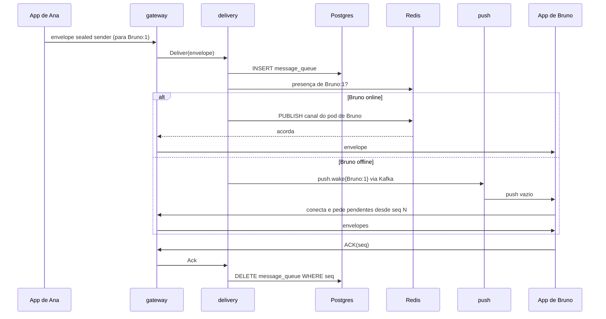
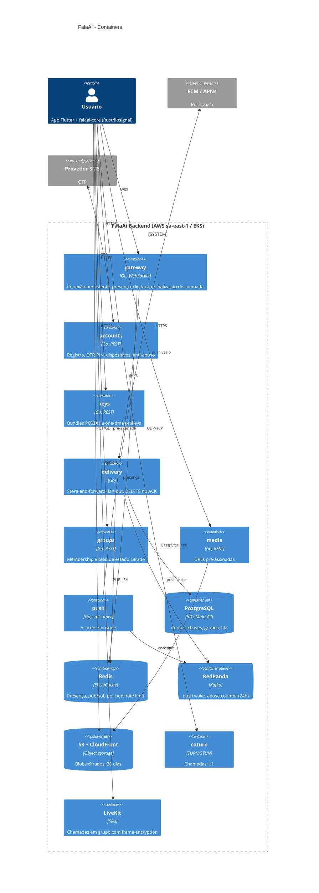

# 03 — Backend e infraestrutura

## Decisão central: servidor Go construído do zero

O servidor de um mensageiro E2EE é pequeno por natureza: um **diretório de chaves públicas** + um **relay de ciphertext** + sinalização. O risco está no cliente, que já usa a libsignal. Por isso construímos o servidor em Go, copiando o **desenho de protocolo** do Signal, não o código. Ver [ADR-0004](../adr/ADR-0004-servidor-go-do-zero.md).

- **Signal-Server** (Java, AGPL-3.0) descartado: obrigaria a publicar o servidor, é acoplado a FoundationDB/DynamoDB e enclaves SGX, e o time é Go.
- **Matrix** descartado: usa Olm/Megolm, não Signal Protocol, e expõe muitos metadados ao homeserver (estado de sala, histórico para federação).
- O servidor **não linka libsignal**. Validação de assinaturas XEdDSA/Ed25519 usa implementação Go independente. Isso mantém o servidor fora da AGPL (ver [licenciamento](../legal/licenciamento-agpl.md)).

## Componentes

Seis serviços Go e três componentes de terceiros. Clean Architecture dentro de cada serviço; nada de microserviços finos no MVP. Os seis serviços podem rodar como **um binário com módulos** (modular monolith) no começo e ser separados quando a escala pedir.

| Componente | Responsabilidade | Tecnologia |
|---|---|---|
| `accounts` | Registro por telefone + OTP SMS, PIN de registro, username, dispositivos, tokens de dispositivo, push tokens, anti-abuso básico | Go, gin, Postgres |
| `keys` | Bundles por dispositivo (identity, signed prekey, Kyber prekeys, one-time prekeys); entrega um bundle por fetch e consome a one-time; rate limit por par (solicitante, alvo) | Go, gin, Postgres |
| `gateway` | Única conexão persistente do app (WebSocket). Autentica dispositivo, registra presença em Redis, recebe e empurra envelopes, recebe ACKs, relay efêmero de digitação e sinalização de chamada | Go, `coder/websocket`, Redis |
| `delivery` | Store-and-forward: grava envelope na fila do dispositivo destino, acorda o pod do destino via Redis, publica `push.wake` se offline. **DELETE após ACK**, TTL de 30 dias. Fan-out de grupo | Go, Postgres particionado |
| `groups` | Membership e papéis (UUIDs), versão do grupo, blob de estado cifrado, convites por link | Go, gin, Postgres |
| `media` | URLs pré-assinadas PUT/GET; servidor só conhece `object_id` e tamanho; expiração 30 dias | Go, S3, CloudFront |
| `push` | Consome `push.wake` e envia FCM/APNs **vazio**; debounce de 1 push a cada 30s por dispositivo; VoIP push para chamadas | Go, consumer Kafka |
| coturn | TURN/STUN para chamadas 1:1; credenciais efêmeras (TURN REST API, HMAC, validade 1h) emitidas pelo gateway | coturn em EC2 com IP fixo |
| LiveKit | SFU para chamadas em grupo, com frame encryption (o SFU não decifra) | LiveKit self-hosted (Go/Pion, Apache-2.0) |

Por que **LiveKit**: SDK Flutter oficial, E2EE por frame, multi-nó via Redis, escrito em Go. mediasoup exigiria escrever toda a sinalização em Node; ion-sfu está sem manutenção desde 2023. Ver [ADR-0005](../adr/ADR-0005-livekit-e-coturn.md).

**Kafka (RedPanda) fica fora do caminho quente.** Mensagens nunca passam por Kafka. Só eventos sem par remetente/destinatário: `push.wake{device}` e `abuse.counter{uuid, tipo}`, com retenção de 24h.

## Protocolo cliente-servidor

- **WebSocket** (`wss://gw.falaai.com.br/v1/ws`) para envelopes, ACKs, presença, digitação e sinalização de chamada. Frames em protobuf (`falaai-proto`).
- **REST/JSON sobre HTTPS** para registro, chaves, grupos, mídia, perfil. Contrato OpenAPI gerado a partir de `falaai-proto`.
- Não usamos GraphQL aqui: superfície pequena, binária e orientada a streams.

## Fluxo de entrega



Garantia: **at-least-once**; o cliente deduplica por `seq` e `client_message_id`. Postgres é a fonte da verdade; o pub/sub do Redis é só "acorde".

## Modelo de dados mínimo

```sql
accounts(aci uuid PK, phone_hmac bytea UNIQUE, phone_enc bytea, username text UNIQUE NULL,
         reg_lock_verifier bytea NULL, created_at timestamptz, deleted_at timestamptz NULL)
devices(aci uuid, device_id int, auth_token_hash bytea, push_token_enc bytea NULL,
        platform text, last_seen_day date, PRIMARY KEY (aci, device_id))
identity_keys_log(aci uuid, device_id int, public_key bytea, seen_at timestamptz)  -- append-only (key transparency futura)
signed_prekeys(aci, device_id, key_id, public_key, signature)
kyber_prekeys(aci, device_id, key_id, public_key, signature, last_resort bool)
one_time_prekeys(aci, device_id, key_id, public_key)
message_queue(recipient_aci uuid, recipient_device int, seq bigserial, envelope bytea,
              server_ts timestamptz, expires_at timestamptz) PARTITION BY HASH (recipient_aci)
groups(group_id bytea PK, version int, state_blob bytea, updated_at timestamptz)
group_members(group_id bytea, aci uuid, role smallint)
media_objects(object_id uuid PK, size_bucket int, expires_at timestamptz)  -- sem dono
abuse_reports(reporter_aci uuid, reported_aci uuid, created_at timestamptz)
access_log(occurred_at timestamptz, ip inet, port int, aci uuid)  -- Marco Civil art. 15, 6 meses, cifrado
admin_audit_log(...)  -- append-only, ações de operadores
```

Observações:

- `message_queue` **não guarda remetente** (sealed sender).
- `last_seen_day` tem granularidade de dia, nunca timestamp.
- Rate limits vivem no Redis com TTL; IP em Redis no máximo 24h.

### Retenção

| Dado | Retenção |
|---|---|
| Envelope na fila | Apagado no ACK; TTL de 30 dias |
| Blob de mídia | 30 dias (lifecycle do S3) |
| Prekey one-time | Apagada ao ser entregue |
| Registros de acesso (`access_log`) | 6 meses (obrigação legal), cifrados, acesso só com ordem judicial |
| Conta excluída | Apagada em 24h; `phone_hmac` como tombstone por 30 dias (anti-abuso) |
| Logs de aplicação | 7 dias, sem identificadores de usuário |

### Conflito com "append-only, sem DELETE"

O padrão de imutabilidade (outbox, CDC, tópicos longos) **cria exatamente o grafo social que prometemos não ter**. Decisão ([ADR-0008](../adr/ADR-0008-fila-mutavel-sem-append-only.md)):

1. A fila de mensagens é mutável e apagada. Sem outbox, sem CDC, sem Debezium.
2. Kafka só carrega eventos sem par remetente/destinatário, com retenção de 24h.
3. Append-only só em `identity_keys_log` e `admin_audit_log`.

## Escala e topologia

**MVP (100 mil usuários, ~20 mil conexões simultâneas, ~50 msg/s no pico):**

- `gateway`: 3 pods (um por AZ), ~10 mil conexões cada.
- Roteamento: `HSET presence <aci:device> <pod_id>` + um canal pub/sub **por pod** (não por usuário).
- Postgres: RDS Multi-AZ, 1 writer + 1 reader; `message_queue` com 32 partições hash.
- Redis: ElastiCache, 2 nós. RedPanda: 3 brokers pequenos.
- Região única (sa-east-1), 3 AZs.

**10 milhões de usuários (~2 milhões de conexões, ~5 mil msg/s):**

- 150 a 200 pods de gateway; Redis Cluster; avaliar NATS JetStream para fan-out entre pods.
- `message_queue` sai do Postgres para ScyllaDB ou DynamoDB, chaveada por dispositivo.
- `keys` com sharding por ACI (pool de one-time prekeys vira hotspot).
- TURN/SFU em São Paulo **e** Fortaleza para latência no Norte/Nordeste.
- DR com região secundária passiva.

## Hospedagem

**AWS sa-east-1 no MVP** ([ADR-0006](../adr/ADR-0006-aws-sa-east-1-no-mvp.md)):

- Dados ficam no Brasil; o time já opera EKS, RDS, Pulumi e ArgoCD.
- Risco CLOUD Act declarado publicamente. Atinge só metadados; o conteúdo é ciphertext.
- **OCI São Paulo** é o destino de coturn e LiveKit quando o egress passar de ~20 TB/mês (10 TB/mês gratuitos e preço de egress muito menor que os ~US$ 0,15/GB da AWS em sa-east-1).
- **Magalu Cloud**: Kubernetes gerenciado em GA desde janeiro de 2026. Reavaliar em 2027 para a narrativa "nuvem brasileira".

## Observabilidade sem vazar metadados

- **Proibido em log, métrica e trace:** telefone, par remetente/destinatário, IP completo, tamanho exato de envelope, `object_id` de mídia, ACI em claro.
- Identificador em log: `device_hash = HMAC(salt_diário, aci:device)`. Correlaciona dentro do dia, não entre dias.
- Lint de logs no `make lint` (regra `forbidigo` do golangci-lint) + scanner de dados sensíveis no provedor de observabilidade como rede de segurança.
- Traces com 1% de amostragem e sem atributos de usuário.
- Logs: 7 dias, sem arquivamento. Métricas agregadas: 15 meses.
- Acesso à produção via SSO + break-glass, gravado em `admin_audit_log`.

## Anti-abuso sem ler conteúdo

- Rate limit por dispositivo, IP e número (registro, fetch de bundle, mensagens para destinatários novos).
- Play Integrity (Android) e App Attest (iOS) no registro.
- **Pedidos de mensagem:** conversa de desconhecido fica em quarentena até o destinatário aceitar.
- Denúncia feita pelo destinatário, que pode anexar voluntariamente as mensagens recebidas (já decifradas no aparelho dele).
- Contadores agregados de denúncia levam a suspensão. Nunca hash de conteúdo, nunca varredura no cliente.

## Diagrama de containers (C4 nível 2)


